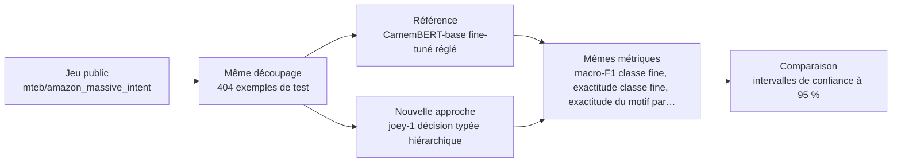
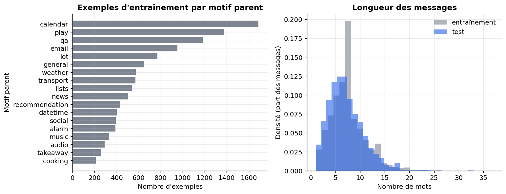
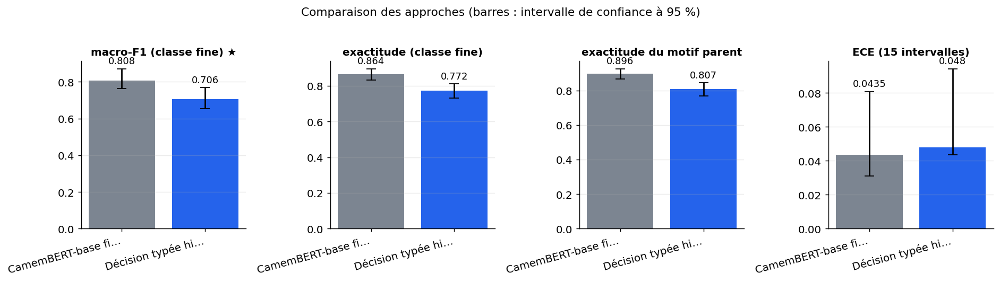
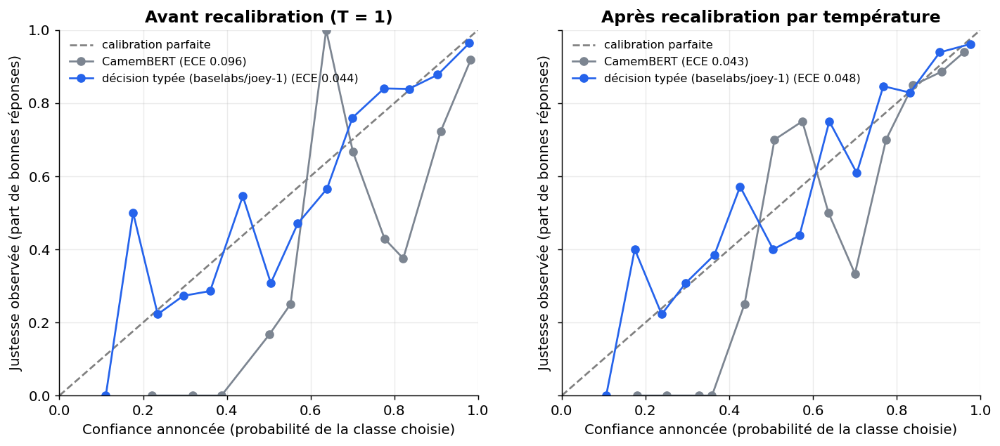
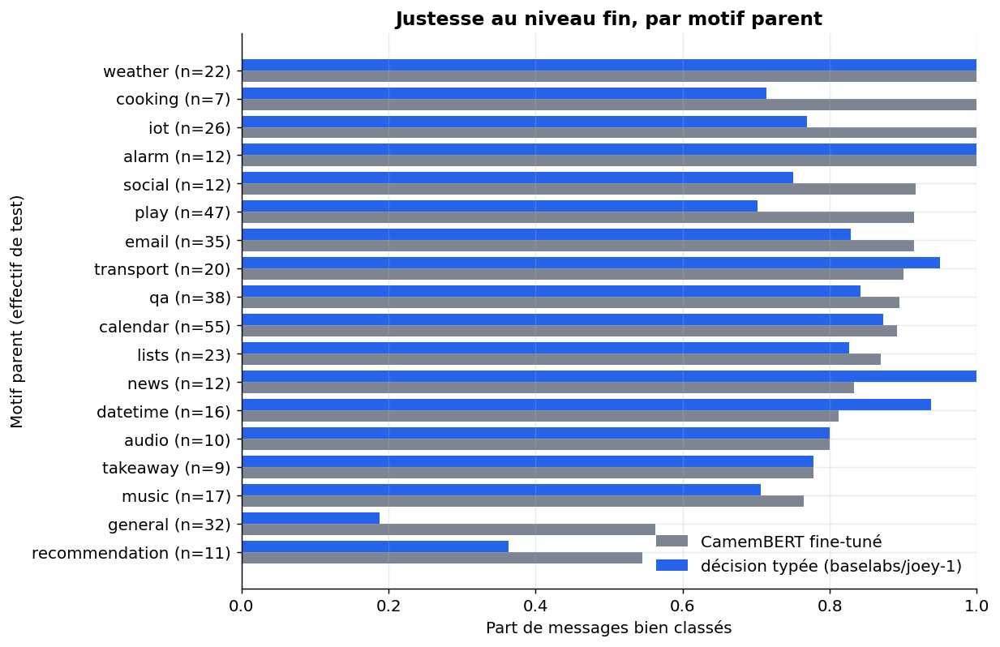
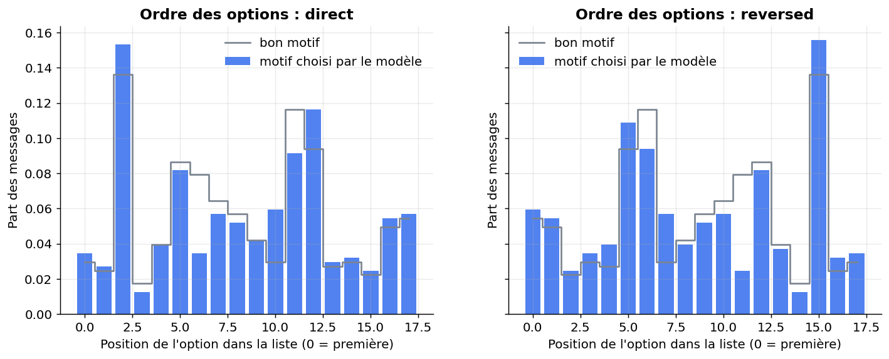

# Un modèle de décision typé entraîné pour la calibration (joey-1) rattrape-t-il un classifieur CamemBERT bien réglé sur des intentions françaises hiérarchisées ?

> **En bref.** Le zéro-shot ne rattrape pas un CamemBERT bien réglé sur ces intentions françaises ; il pourrait servir de premier tri sous seuil, mais sa calibration et son coût restent à valider sur données internes. macro-F1 (classe fine) : 0,706 [0,653 ; 0,769] pour Décision typée hiérarchique (baselabs/joey-1), contre 0,808 [0,765 ; 0,871] pour CamemBERT-base fine-tuné (404 exemples de test, échelle complète).

## Sommaire

1. [La question](#la-question)
2. [Le protocole](#le-protocole)
3. [Les résultats](#les-résultats)
4. [Ce qu'il faut retenir](#ce-quil-faut-retenir)
5. [Rejouer l'expérience](#rejouer-lexpérience)
6. [Contenu du dépôt](#contenu-du-dépôt)
7. [Références](#références)
8. [Glossaire](#glossaire)

## La question

On se demande si un modèle de décision, joey-1, peut ranger des messages français par motif puis par sous-motif aussi bien qu'un classifieur CamemBERT entraîné sur des exemples annotés, alors qu'on ne lui en montre aucun. joey-1 ne rédige aucun texte : il rend une probabilité pour chaque case d'un formulaire à choix. On lui demande d'abord le motif, puis la demande précise, en présentant les options dans deux ordres pour éviter qu'il préfère une position. Pour qu'il soit servi tel qu'il a été entraîné, on le charge depuis un dossier local à une version fixée, et la mesure est bornée dans le temps. La comparaison porte sur la justesse, la fiabilité des probabilités et la stabilité quand on change l'ordre des options. Elle indique si un tri sans données annotées est envisageable ou s'il vaut mieux garder un classifieur entraîné.

**Hypothèse testée.** En zéro-shot, avec décision hiérarchique (scénario puis intention) et moyenne sur deux ordres d'options, joey-1 atteint un macro-F1 à moins de 5 points d'un CamemBERT-base fine-tuné correctement (10 époques, sélection sur validation), avec une ECE < 0,05 après recalibration, un accord > 90 % sous permutation des options et des erreurs de parent < 20 %.

| | Référence | Nouvelle approche |
|---|---|---|
| **Approche** | CamemBERT-base fine-tuné (réglé) | joey-1 décision typée hiérarchique |
| **Principe** | Classifieur à tête linéaire sur 60 intentions, entraîné plus longtemps que dans l'expérience antérieure, avec sélection de l'époque sur la validation et recalibration par température. | Modèle de décision de 2 Md (post-entraîné de Qwen3.5-2B) qui rend une probabilité par option en une passe ; interrogé en deux questions de choix : scénario puis intention parmi les enfants, probabilités multipliées, moyennées sur deux ordres d'options. |
| **Mise en œuvre** | transformers AutoModelForSequenceClassification sur almanach/camembert-base ; lr 5e-5, 10 époques, batch 32, warmup 10 %, poids de décroissance 0,01, meilleur point de contrôle par macro-F1 de validation ; température ajustée sur validation ; parent déduit du préfixe de l'étiquette. | Runtime `qev` du dépôt OmniJev/OneJev, commit 81ce62f1597c91e46767d4d02d6ac2e18534fe94, avec le correctif `serve.patch` du dépôt du modèle (voir son `setup.sh`), et non le paquet PyPI homonyme ; `DecisionEngine` chargé depuis un dossier local à la révision épinglée, seule façon de lui faire lire la configuration d'entraînement (attention non causale, lecture slot_lm), et `SystemOneRequest`, sur GPU ; questions de type choice avec criteria = {libellé : libellé} (label_text) ; deux ordres (direct et inversé) moyennés ; température de recalibration unique par niveau ajustée sur validation. Aucun entraînement. Diagnostic du biais d'ordre : distribution des positions choisies et accord restreint aux cas corrects. |
| **Modèles** | [`almanach/camembert-base`](https://huggingface.co/almanach/camembert-base) | [`baselabs/joey-1`](https://huggingface.co/baselabs/joey-1) |

## Le protocole



- **Données** : [`mteb/amazon_massive_intent`](https://huggingface.co/datasets/mteb/amazon_massive_intent) (configuration `fr`), évaluation sur le découpage `test` (404 exemples). Seul jeu français chargeable offrant un arbre à deux niveaux, 60 classes proches et libellés en clair ; même jeu que l'expérience antérieure, donc résultats comparables ; permet de mesurer cohérence parent/enfant, macro-F1, ECE et stabilité à l'ordre.
- **Écarts avec des données réelles** : Énoncés d'assistant vocal très courts, pas de services financiers ; 60 classes au lieu de ~300 ; ni e-mails ni pièces jointes ; joey-1 annoncé anglais seul ; la conclusion reste indicative.
- **Déroulé** : Le test de MASSIVE en français est sous-échantillonné de façon stratifiée à 1 500 énoncés tirés au hasard avec la graine. CamemBERT-base est entraîné sur tout le split train (10 époques, lr 5e-5, warmup 10 %), l'époque est choisie au meilleur macro-F1 de validation, puis une température est ajustée sur la validation. joey-1 est interrogé en zéro-shot depuis un dossier local à la révision épinglée, pour qu'il lise sa configuration d'entraînement (attention non causale, lecture slot_lm). Il répond à deux niveaux de questions de choix (tous les motifs, puis les enfants), chaque question étant posée dans deux ordres moyennés, avec une température par niveau. La boucle de test a un budget de 60 min : les deux approches sont évaluées sur les mêmes messages atteints, au moins 100, et leur nombre figure dans les résultats. On mesure le macro-F1, les exactitudes, la part d'erreurs de motif, l'ECE (15 intervalles), le Brier, l'accord sous trois ordres et la latence P95, avec des IC à 95 % par bootstrap, un bootstrap apparié et un test de McNemar.
- **Deux échelles, un seul code** : l'échelle réduite (100 exemples, CPU, 6 min) valide la mécanique ; l'échelle complète (GPU T4 (Google Colab), 83 min) donne les résultats.



*À gauche, les effectifs d'entraînement par motif parent ; à droite, la distribution des longueurs en mots (entraînement et test). Des courbes proches signalent un test représentatif.*

**Les métriques**

| Métrique | Ce qu'elle mesure | Meilleur si |
|---|---|---|
| macro-F1 (classe fine) ★ | Moyenne, sur toutes les intentions, du compromis entre précision et rappel ; chaque classe pèse autant, qu'elle soit rare ou fréquente. | plus haut |
| exactitude (classe fine) | Part des messages dont l'intention exacte est trouvée. | plus haut |
| exactitude du motif parent | Part des messages dont au moins le motif de premier niveau est juste. | plus haut |
| part des erreurs de motif parent | Parmi les messages mal classés, part de ceux dont même le motif est faux : ce sont les erreurs qui envoient le message dans la mauvaise file. | plus bas |
| ECE (15 intervalles) | Écart moyen entre la confiance annoncée par le modèle et la part de réponses justes à ce niveau de confiance. | plus bas |
| score de Brier multiclasse | Erreur quadratique entre les probabilités données et la bonne réponse, sur toutes les classes (0 = parfait). | plus bas |
| accord sous permutation des options | Part des messages qui reçoivent la même décision avec les trois ordres d'options (sans objet pour CamemBERT). | plus haut |
| latence P95 (ms, lot de 1) | Temps de décision en dessous duquel tombent 95 % des messages traités un par un. | plus bas |

★ métrique principale : c'est elle qui tranche la question.

## Les résultats

| Approche | macro-F1 (classe fine) ★ ↑ | exactitude (classe fine) ↑ | exactitude du motif parent ↑ | part des erreurs de motif parent ↓ | ECE (15 intervalles) ↓ | score de Brier multiclasse ↓ | accord sous permutation des options ↑ | latence P95 (ms, lot de 1) ↓ | Latence médiane (ms) ↓ |
|---|---|---|---|---|---|---|---|---|---|
| CamemBERT-base fine-tuné (référence) | **0,808 [0,765 ; 0,871]** | **0,864 [0,832 ; 0,896]** | **0,896 [0,866 ; 0,926]** | **0,764 [0,65 ; 0,879]** | **0,0435 [0,0311 ; 0,0808]** | **0,223 [0,173 ; 0,279]** | — | **17** | 14,3 |
| Décision typée hiérarchique (baselabs/joey-1) (nouvelle approche) | 0,706 [0,653 ; 0,769] | 0,772 [0,73 ; 0,812] | 0,807 [0,767 ; 0,844] | 0,848 [0,768 ; 0,916] | 0,048 [0,0436 ; 0,0942] | 0,332 [0,281 ; 0,382] | 0,921 [0,896 ; 0,946] | 8,25e+03 | 8,22e+03 |

★ métrique principale · ↑ plus haut = meilleur · ↓ plus bas = meilleur · entre crochets : intervalle de confiance à 95 % (bootstrap) · en gras : la meilleure valeur.



*Valeur de chaque métrique par approche (★ : métrique principale, à maximiser) ; les barres d'erreur donnent l'intervalle de confiance à 95 % sur 404 exemples de test.*



*Justesse observée selon la confiance annoncée, avant (gauche) et après (droite) recalibration. Sous la diagonale : modèle trop sûr de lui. L'ECE résume l'écart moyen à la diagonale.*



*Part de messages bien classés au niveau fin, pour chaque motif parent et chaque approche. Les motifs à faible effectif (n) donnent des barres peu stables.*



*Position, dans la liste présentée, du motif choisi (barres) et du bon motif (ligne), pour l'ordre direct et l'ordre inversé. Un écart systématique sur une position révèle un biais d'ordre.*

**Lecture** (confiance moyenne). À l'échelle complète (GPU T4, 404 énoncés de test sur 1500 prévus, mêmes messages pour les deux approches), CamemBERT-base bien réglé obtient un macro-F1 de 0,81 contre 0,71 pour joey-1 en zéro-shot hiérarchique. L'écart de −10,2 points (intervalle −16,5 à −4,7) rejette l'hypothèse « à moins de 5 points ». L'exactitude suit (0,86 contre 0,77), et McNemar donne 48 messages justes pour la référence seule contre 11. La calibration après recalibration (ECE 0,048 contre 0,043) et l'accord sous permutation (0,92) sont proches des seuils, mais non tranchés vu les intervalles. Le Brier est moins bon (0,33 contre 0,22), et la latence de 8,2 s contre 14 ms ne se compare pas au 20 ms de la fiche. Les chiffres de l'échelle réduite (substitut, micro-modèle) ne valent que pour le code. Conclusion indicative : jeu d'assistant vocal, hors services financiers, langue française.

## Ce qu'il faut retenir

**Réserves**

- Les chiffres reposent sur 404 énoncés, soit environ un quart du test prévu. Les écarts fins (calibration, accord sous permutation) ne sont pas tranchés ; seul l'écart de justesse est net.
- La calibration et la stabilité de joey-1 sont compatibles avec les seuils visés, mais pas démontrées : l'incertitude couvre les deux côtés. Le score de Brier, lui, est nettement moins bon que celui de la référence.
- Le chiffre de « part des erreurs de motif » ne se compare pas au seuil de 20 %. Sur l'ensemble des messages, joey-1 se trompe de motif environ une fois sur cinq, contre environ une fois sur dix pour CamemBERT.
- Le rapport de latence d'environ 500 contre CamemBERT vient surtout du protocole hiérarchique à une trentaine de questions sur un GPU modeste. Il ne contredit ni ne confirme le 20 ms annoncé.

**Limites**

- MASSIVE (énoncés vocaux très courts, 60 classes, libellés en anglais posés à un modèle documenté en anglais seulement) diffère des messages internes en services financiers : la conclusion reste indicative.
- Le nombre de messages réellement évalués dépend du GPU et du budget de temps : il est donné dans les résultats, et des intervalles plus larges sont à attendre s'il est loin des 1 500 prévus.
- `causal-conv1d`, prévu par le `setup.sh` du modèle, n'est pas installé : son calcul de référence, `F.conv1d`, est le même. `triton` n'est installé que sur le GPU (`triton==3.6.0`, absent de `requirements.txt`) ; le rapport d'exécution conservé avec les résultats indique le noyau d'attention linéaire réellement utilisé.
- En phase private, le runtime OneJev corrigé et le dossier du modèle, poids compris, doivent être préparés à l'avance, faute d'accès à Internet. Si tout le test tient dans `TEST_SIZE`, ses premiers messages sont les plus anciens : le budget de temps doit alors couvrir tout le test, sinon l'échantillon évalué n'est plus aléatoire.
- Les températures du modèle de décision sont ajustées sur un sous-échantillon de validation (500 messages), et la confiance mesure la concentration des probabilités, pas la justesse : tout seuil d'escalade doit être validé sur données internes.

**Pistes d'amélioration**

- L'écart avec CamemBERT est probablement un peu pessimiste pour joey-1 (libellés pauvres, langue non prévue). Une éventuelle présence de MASSIVE dans ses données d'entraînement jouerait en sens inverse.
- La mesure ne dit rien sur la capacité de joey-1 à s'abstenir. Le seuil d'escalade reste à valider sur des données internes.

## Rejouer l'expérience


### Sur le jeu public

```bash
pip install -r requirements.txt
jupyter lab experiment.ipynb
```

Dans la cellule de paramètres : `PHASE = "public"`, puis `SCALE = "reduced"` (quelques minutes sur CPU, pour vérifier) ou `SCALE = "full"` (résultats publiés ; GPU T4 (Google Colab), 83 min). Les résultats sont écrits dans `outputs/results_public.json`, les figures dans `outputs/figures/` (les résultats publiés en sont une copie, dans `results/` et `figures/`).

### Sur vos données (environnement de services financiers)

Le même protocole, sur vos données, dans votre environnement : seule la cellule `PRIVATE_CONFIG` s'adapte. Le code de cette phase a été exécuté de bout en bout sur un jeu factice écrit comme un vrai export (dossier de fichiers, CSV « ; » en Windows-1252, colonnes à faire correspondre), contre un service simulé à la convention OpenAI (clé lue dans un fichier de secret), modèles chargés hors ligne.

**1. Préparer le jeu de données.** Colonnes attendues (les noms peuvent différer : on les fait correspondre dans `PRIVATE_CONFIG["columns"]`) :

| Colonne attendue | Type | Contenu |
|---|---|---|
| `text` | string | Texte du message ou de l'e-mail, anonymisé |
| `reason` | string | Motif (niveau parent) validé |
| `sub_reason` | string | Sous-motif (niveau enfant) validé |
| `reason_description` | string | Libellé en clair et description de chaque classe, pour l'interrogation en langage naturel |
| `received_at` | datetime | Date de réception, pour le découpage temporel |
| `channel` | string | Canal (e-mail, chat, formulaire) |

Volume conseillé : Au moins 5 000 messages annotés, dont ≥ 20 par sous-motif pour les classes évaluées et un échantillon de test de 1 000 messages minimum.

**Conditions pour que la comparaison soit concluante**

- Annotation des motifs et sous-motifs par au moins deux annotateurs sur un sous-ensemble de 500 messages, avec accord inter-annotateurs (kappa) rapporté.
- Au moins 20 exemples par sous-motif en entraînement et 5 en test ; classes rares signalées séparément.
- Découpage temporel (entraînement antérieur au test) et par client pour éviter les fuites ; au moins 6 mois couverts pour la saisonnalité.
- Texte en français UTF-8, longueur inférieure à 16 000 tokens ; pièces jointes exclues ou converties en texte, la longueur maximale du modèle étant rejetée et non tronquée.
- Anonymisation des noms, IBAN, numéros de carte et adresses avant extraction ; exclusion des messages juridiques ou contentieux sensibles.
- Libellés et descriptions de classes fournis et figés avant l'évaluation, taxonomie versionnée.
- Distribution réelle des classes conservée dans le test (pas de rééquilibrage) pour que l'ECE reste interprétable.

**Constituer l'extraction.** Extraire les messages entrants d'un ou plusieurs canaux avec le motif et le sous-motif validés par un conseiller, joindre la description officielle de chaque classe, filtrer les doublons, les messages vides et les réponses automatiques, puis échantillonner par strate de sous-motif en gardant un test non rééquilibré. Découper dans le temps puis par client.

**2. Rendre les modèles disponibles hors ligne** (si l'environnement n'a pas accès à Internet) :

```bash
python download_models.py ./models --scale full   # sur un poste connecté
```

puis copier le dossier dans l'environnement et le désigner par `LOCAL_MODELS_DIR`. Les révisions téléchargées sont celles des résultats publiés.

**3. Configurer** l'environnement du notebook à partir de `private.env.example` (ou directement la cellule `PRIVATE_CONFIG`). Jamais de clé dans le notebook : une variable, un fichier de secret monté ou la saisie masquée.

| Variable | Rôle |
|---|---|
| `PRIVATE_DATA` | jeu de données : fichier ou dossier (csv, tsv, parquet, jsonl, json, xlsx) ; `fake` pour tester le code sur un jeu factice |
| `LOCAL_MODELS_DIR` | (facultatif) dossier des poids copiés localement (`org--nom/`), pour travailler sans Internet |
| `HTTPS_PROXY, SSL_CERT_FILE, PIP_INDEX_URL` | (facultatif) proxy, autorité de certification et miroir PyPI d'entreprise |
| `SERVICE_TIMEOUT_S, SERVICE_MAX_RETRIES` | (facultatif) délai (120 s) et tentatives (3) par appel de service |

**4. Lancer** avec `PHASE = "private"` (et `SCALE = "full"`). La cellule d'initialisation affiche une liste de contrôle (jeu, colonnes, modèles, services) et s'arrête sur ce qui manque, avant tout calcul. Les résultats sont écrits dans `outputs/results_private.json` (avec versions, machine, graine et empreinte des données).

**5. Interpréter.** Métriques métier à suivre : Macro-F1 sous-motif, exactitude du motif, taux d'incohérence motif/sous-motif, ECE, couverture à précision fixée (≥ 95 %) avec seuil d'escalade, latence P95, coût par 1 000 messages.

**Garde-fous.** Pas de décision automatique sans seuil validé sur données internes ; la confiance du modèle mesure la concentration des probabilités, pas la justesse ; revue humaine des classes à fort enjeu ; données hébergées en environnement maîtrisé, aucun envoi vers une API externe. En phase `private`, le notebook refuse les services publics (OpenAI, Anthropic, Mistral, Hugging Face…) et le HTTP non chiffré, n'affiche aucune donnée brute et coupe la télémétrie des bibliothèques ; avec `LOCAL_MODELS_DIR`, il travaille sans accès à Internet.

## Contenu du dépôt

| Fichier | Contenu |
|---|---|
| `experiment.ipynb` | le notebook : question, données, deux approches, évaluation, analyse, bilan (sorties incluses) |
| `helpers.py` | fonctions communes : phases et échelles, services internes, lecture des données, mesures, figures |
| `results/results.json` | résultats publiés (échelle complète) : métriques, intervalles, latences, versions et machine |
| `results/results_reduced_scale.json` | résultats de l'échelle réduite (validation de la mécanique, CPU) |
| `figures/` | figures du notebook reprises dans ce README |
| `requirements.txt` | versions exactes des bibliothèques utilisées |
| `private.env.example` | variables d'environnement pour exécuter le notebook sur vos données |
| `download_models.py` | téléchargement des poids des modèles, pour un environnement sans Internet |

## Références

**Sources de l'approche**

- [Decisions for a penny: introducing joey-1, our fastest decision model (Baseten)](https://baseten.co/blog/decisions-for-a-penny-introducing-joey-1/)
- [baselabs/joey-1 — fiche du modèle (Hugging Face)](https://huggingface.co/baselabs/joey-1)
- [Introducing AnySpeechRecognizer and AnyDecisionModel (Hugging Face Blog)](https://huggingface.co/blog/anydecisionmodel)
- [Arize-ai/phoenix arize-phoenix v20.27.0](https://github.com/Arize-ai/phoenix/releases/tag/arize-phoenix-v20.27.0)
- [Baseten Releases joey-1, a 2B Decision Model at $0.01 per 1M Tokens (MarkTechPost)](https://www.marktechpost.com/2026/10/29/baseten-joey-1-2b-decision-model/)
- [Blog Baseten (index des billets)](https://www.baseten.co/blog/)

**Autres jeux de données examinés**

| Jeu | Accès | Intérêt | Pourquoi pas ici |
|---|---|---|---|
| [DeepPavlov/banking77_fr](https://huggingface.co/datasets/DeepPavlov/banking77_fr) | Hugging Face, libre | 77 intentions de services financiers proches, 10k/3k. | Pas d'arbre officiel, licence Hub vide, libellés à joindre depuis la version anglaise ; piste pour une suite. |
| [mteb/MTOPIntentClassification](https://huggingface.co/datasets/mteb/MTOPIntentClassification) | Hugging Face, libre | ~110 intentions déséquilibrées, bon pour les classes rares. | Étiquettes sans noms, appariement domaine/intention non vérifié, licence floue. |
| [mteb/banking77](https://huggingface.co/datasets/mteb/banking77) | Hugging Face, libre | Version anglaise avec libellés, isole l'effet de la langue. | Anglais, pas de hiérarchie. |
| [mteb/amazon_reviews_multi](https://huggingface.co/datasets/mteb/amazon_reviews_multi) | Hugging Face, libre | Avis longs, 5 notes ordinales. | Seulement 5 classes, sans hiérarchie, licence floue. |
| [Mozilla/query-intent-detection-dataset-french](https://huggingface.co/datasets/Mozilla/query-intent-detection-dataset-french) | Hugging Face, libre | Garde-fou binaire en français. | Deux classes, hors question centrale. |
| [E-mails synthétiques de relation client (EDF R&D, PFIA 2025)](https://pfia2025.u-bourgogne.fr/Articles/Docs/G%C3%A9n%C3%A9ration%20dune%20base%20de%20courriers%20%C3%A9lectroniques%20synth%C3%A9tiques%20par%20des%20grands%20mod%C3%A8les%20de%20langue%20dans%20le%20domaine%20de%20la%20relation%20client.pdf) | sur demande | ~1 600 e-mails français de relation client, le plus proche du canal réel. | Publication du jeu non confirmée ; à demander aux auteurs. |

**Licences**

- Jeu de données `mteb/amazon_massive_intent` : apache-2.0
- `almanach/camembert-base` : mit
- `baselabs/joey-1` : mit
- `Qwen/Qwen3-0.6B` : apache-2.0
- Vérifier la licence de chaque modèle avant tout usage au-delà de l'évaluation.

## Glossaire

| Terme | Définition |
|---|---|
| **Zéro-shot** | Utiliser un modèle sur une tâche sans lui avoir montré aucun exemple annoté de cette tâche. |
| **Fine-tuning** | Poursuivre l'entraînement d'un modèle déjà pré-entraîné sur des exemples annotés de la tâche visée. |
| **Calibration** | Accord entre la confiance annoncée et la justesse réelle : sur les réponses données à 80 %, environ 80 % doivent être justes. |
| **Recalibration par température** | Division des scores par un nombre T avant de les transformer en probabilités, pour les rendre plus ou moins tranchées sans changer la classe choisie. |
| **Biais de position** | Tendance d'un modèle à préférer une option selon sa place dans la liste plutôt que selon son contenu. |
| **Attention non causale** | Mode de lecture où chaque mot du texte peut tenir compte de tous les autres, avant comme après lui ; joey-1 a été entraîné ainsi. |
| **Micro-modèle** | Copie très réduite d'un modèle (même architecture, poids aléatoires) qui sert seulement à vérifier que le code tourne. |
| **Bootstrap** | On retire de nombreuses fois des exemples au hasard, avec remise, pour voir à quel point un chiffre dépend de l'échantillon. |
| **Budget de temps** | Durée maximale accordée à une boucle coûteuse ; à son terme, elle s'arrête proprement et l'on évalue sur les exemples déjà traités. |
